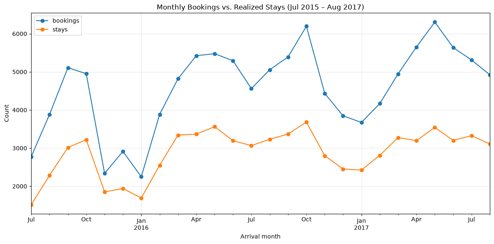
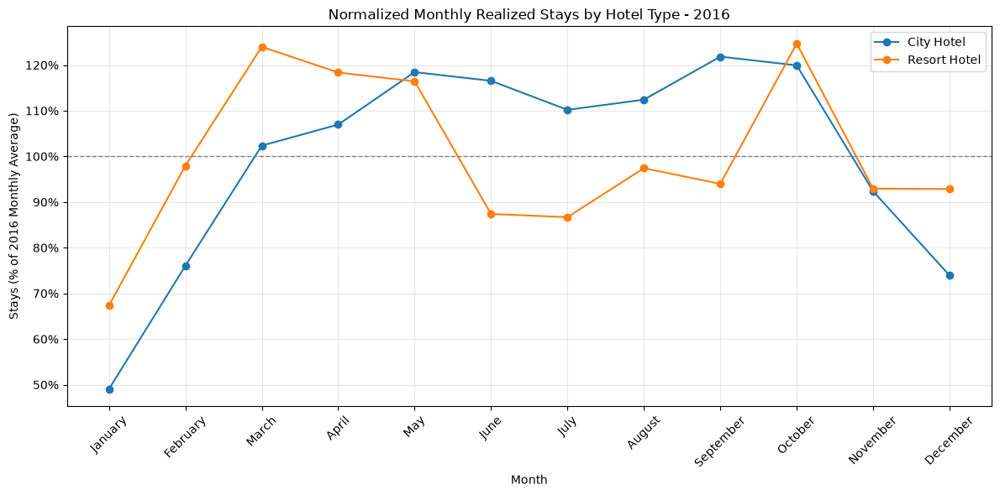
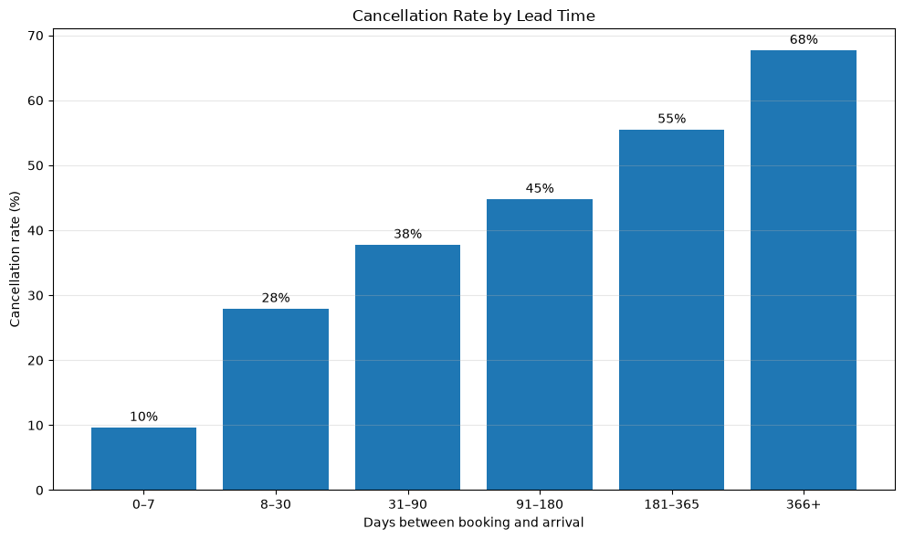
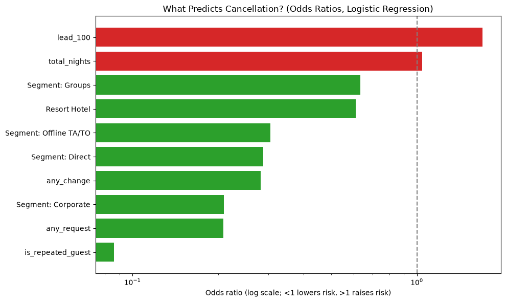

# Hotel Booking Demand & Cancellation Analysis

Analysis of booking demand, seasonality, and cancellations for two hotels in Portugal, ending with a
logistic regression that predicts which bookings will be canceled.

**Tools:** Python (pandas, NumPy, Matplotlib, statsmodels, scikit-learn), Jupyter

## Key Results

- **Bookings overstate demand.** 37% of bookings are canceled. From January–August 2016 to January–August 2017, bookings grew **10.5%** but realized stays grew only **3.7%**.
- **Lead time is the strongest cancellation signal.** Cancellation rates rise from **10%** for bookings made within a week of arrival to **68%** for bookings made more than a year ahead.
- **Engaged and loyal guests rarely cancel.** Repeat guests cancel 15% of the time vs. 38% for first-time guests; guests with no special requests cancel 48% of the time vs. about 22% for those with at least one.
- **An apparent anomaly explained.** Non-refundable bookings cancel 99% of the time. Profiling them (88% City Hotel, 63% group bookings, 97% from Portugal, median lead time 183 days, 93% duplicate rows) suggests group room blocks held by tour operators rather than individual guests.
- **Cancellations are reasonably predictable.** A logistic regression trained on 2015–2016 arrivals reaches an **AUC of 0.75** on unseen 2017 arrivals (70% accuracy vs. a 61% baseline).

## Questions

**Demand**
1. How does booking demand vary across months and years, and is there clear seasonality?
2. How many bookings actually turn into stays, and how does that change the picture of demand?
3. Do the City Hotel and the Resort Hotel follow different seasonal patterns?

**Cancellations**

4. Which booking characteristics are associated with higher cancellation rates?
5. Which factors still predict cancellation when considered together, and how well can a simple model predict it?

## Analysis Highlights

### Bookings vs. realized stays
Counting every booking as demand overstates it: the gap between the two lines is cancellations.



### Seasonality by hotel
Each hotel's monthly stays are normalized by its own average month (100% = a typical month), so the
two hotels can be compared despite their different sizes. The City Hotel falls to about half its
average volume in January and peaks in September; the Resort Hotel peaks in March and October.



### Cancellation risk by lead time



### What predicts cancellation?
Odds ratios from the logistic regression (log scale). Values below 1 lower the odds of cancellation;
values above 1 raise them. Each extra 100 days of lead time raises the odds by about 70%, while special
requests, booking changes, and repeat stays sharply lower them. Group bookings have a high raw
cancellation rate, but once lead time is accounted for their odds are *lower* than online travel
agency bookings, because groups book so far ahead.



## Methods

1. **Data overview:** structure, value ranges, and missing values.
2. **Cleaning:** filled missing values (`children`, `country`, `agent`, `company`); removed 182 impossible rows (bookings with no guests, negative or extreme prices); kept 31,994 identical rows, which are consistent with group bookings recorded one row per room; built an `arrival_date` column.
3. **Demand analysis:** monthly bookings vs. realized stays, year-over-year growth, and hotel-level seasonality normalized by each hotel's average month.
4. **Cancellation analysis:** cancellation rates by lead time, deposit type, market segment, guest history, and special requests.
5. **Modeling:** logistic regression (statsmodels) with a time-based split (train on 2015–2016 arrivals, test on 2017). Variables that leak the outcome or reflect data artifacts were deliberately excluded:
   - `reservation_status` directly reveals whether a booking was canceled.
   - `deposit_type` is dominated by the Non Refund artifact described above.
   - `required_car_parking_spaces` perfectly separates the outcome (no booking with a parking request was canceled), which breaks the model's estimates.

## Recommendations

- **Plan with realized stays, not bookings,** when forecasting occupancy, staffing, and budgets.
- **Manage long-lead and online travel agency bookings more carefully,** for example with stricter deposit terms or targeted overbooking based on predicted cancellation risk.
- **Encourage early engagement** (pre-arrival requests, loyalty perks for repeat guests), which is associated with much lower cancellation rates.

## Limitations

- 2015 and 2017 are partial years (data runs July 2015 – August 2017), and very large 2015-to-2016 growth may partly reflect how data was recorded in the dataset's first months.
- The dataset has no booking ID, so group bookings appear as duplicate rows.
- The model identifies associations, not causes.

## Repository Structure

```
hotel-demand-analysis/
├── hotel_demand_analysis.ipynb   # full analysis with notes on every step
├── figures/                      # charts used in this README
├── requirements.txt
└── README.md
```

## How to Run

1. Download `hotel_bookings.csv` from the [Hotel Booking Demand dataset on Kaggle](https://www.kaggle.com/datasets/jessemostipak/hotel-booking-demand) and place it in the repository folder. (The data file is not included in this repository.)
2. Install the requirements:
   ```
   pip install -r requirements.txt
   ```
3. Open `hotel_demand_analysis.ipynb` and run all cells.

## Data Source

Antonio, N., de Almeida, A., & Nunes, L. (2019). Hotel booking demand datasets. *Data in Brief*, 22, 41–49.

## Author

**Edison Gao** · B.S. Applied Mathematics, UCLA (Dec 2026)
[LinkedIn](https://www.linkedin.com/in/edison-gao-64463937a) · [GitHub](https://github.com/edisongao413-cloud)
